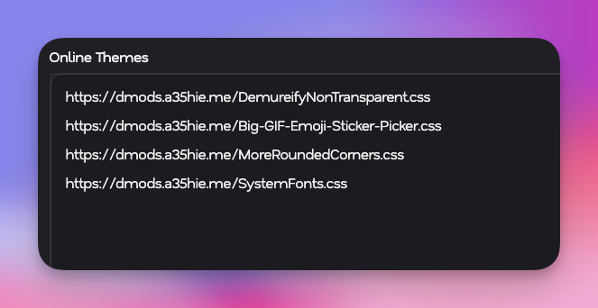

<Note>You will need a Discord client mod to use these styles. Check out [Vencord](https://vencord.dev).</Note>
<Warning>I am not connected to or affiliated with personally to Discord or Vencord. Use client mods at your own risk.</Warning>

# Installation
[<button class="borderedButton">Skip to Themes</button>](#themes)
<Steps>
  <Step title="Install Vencord">
    <Frame>
      
    </Frame>
    Go to Vencord's website and follow instructions to install it.
    [<button class="borderedButton">Vencord</button>](https://vencord.dev/)
  </Step>

  <Step title="Choose your Themes">
    In the list below, find themes you like.
    Alternatively, you can simply install all.
    Copy all themes' URLs that you want to install.

    Simply copy this to install all:

    ```txt All Themes
    https://dmods.a35hie.me/Big-GIF-Emoji-Sticker-Picker.css
    https://dmods.a35hie.me/DemureifyNonTransparent.css
    https://dmods.a35hie.me/Transparency.css
    https://dmods.a35hie.me/SemiOpaqueMain.css
    https://dmods.a35hie.me/SystemFonts.css
    https://dmods.a35hie.me/MoreRoundedCorners-Important.css
    https://dmods.a35hie.me/BlurredHeaders.css
    ```
  </Step>

  <Step title="Install Themes">
    Go to your Discord settings, go to "Themes" under the "Vencord" section, and click "Online Themes" on the top.
    Paste in all your theme URLs into the Online Themes textbox like so:

    <Frame>
      
    </Frame>
  </Step>

  <Step title="Allow Domain">
    Before themes are applied, any non-GitHub/Imgur links will be disallowed.
    Simply go to Settings → Themes and click allow on all the domains.

    <Frame>
      
    </Frame>
  </Step>
</Steps>

---
# Themes
List of themes available for install.
[<button class="borderedButton">Installation Instructions</button>](#installation)

## Transparency

<Frame>
  
</Frame>

This theme provides transparency to the Discord UI.

Also, be sure to check out [Demureify](#demureify) and [Semi-Opaque Main](#semi-opaque-main), which are designed to improve this theme.

<Note>You can get translucency on macOS with [Vencord](https://vencord.dev).</Note>

```txt
https://dmods.a35hie.me/Transparency.css
```

### Enhancements

#### Semi-Opaque Main

Makes the main content slightly darker to contrast the transparent outer level.

```txt
https://dmods.a35hie.me/SemiOpaqueMain.css
```

#### Demureify

Makes elements that are opaque, less opaque with Transparency.

```txt
https://dmods.a35hie.me/DemureifyNonTransparent.css
```

## Beeg GIF/Emoji/Sticker Picker

Enlarge the emoji/GIF/sticker picker.

<Frame>

</Frame>

```txt
https://dmods.a35hie.me/Big-GIF-Emoji-Sticker-Picker.css
```

## More Rounded Corners

Gives some elements more rounded corners.

<Frame>

</Frame>

```txt
https://dmods.a35hie.me/MoreRoundedCorners.css
```

## System Fonts

Use your platform's system font instead of Discord's.

<Frame>

</Frame>

```txt
https://dmods.a35hie.me/SystemFonts.css
```
